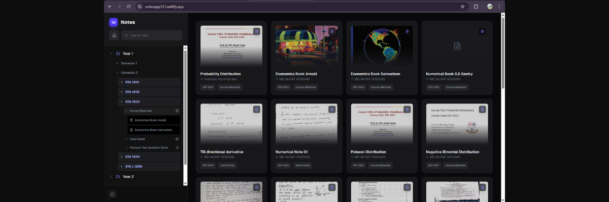
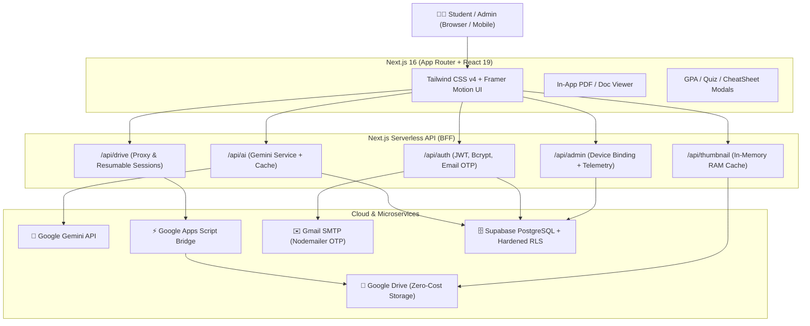

<div align="center">

# 🎓 My Uni Hub

<p><strong>A Next-Gen, AI-Powered Academic Workspace & Zero-Cost Cloud Repository for University Students</strong></p>

[](https://nextjs.org/)
[](https://react.dev/)
[](https://www.typescriptlang.org/)
[](https://tailwindcss.com/)
[](https://supabase.com/)
[](https://deepmind.google/technologies/gemini/)
[](https://www.netlify.com/)
[](https://opensource.org/licenses/MIT)

<br />



</div>

---

## 📑 Table of Contents

- [Overview](#-overview)
- [Why My Uni Hub?](#-why-my-uni-hub)
- [Core Features](#-core-features)
  - [Zero-Cost Cloud Storage Engine](#-1-zero-cost-smart-cloud-storage-engine)
  - [Google Gemini AI Academic Suite](#-2-google-gemini-ai-academic-suite)
  - [Semester GPA Calculator](#-3-semester-gpa-calculator)
  - [Enterprise-Grade Security & 2FA Device Binding](#-4-enterprise-grade-security--2fa-device-binding)
  - [Admin Telemetry & Traffic Dashboard](#-5-admin-telemetry--traffic-dashboard)
  - [Futuristic Glassmorphic UI/UX](#-6-futuristic-glassmorphic-uiux)
- [Architecture & Data Flow](#-system-architecture)
- [Tech Stack](#-tech-stack)
- [Database Schema & Hardening](#-database-schema--rls-hardening)
- [API Reference](#-api-reference)
- [Getting Started](#-getting-started)
  - [Prerequisites](#prerequisites)
  - [Installation](#installation)
  - [Environment Variables](#environment-variables)
  - [Database Setup](#database-setup)
  - [Google Apps Script Storage Bridge](#google-apps-script-storage-bridge)
  - [Running the App](#running-the-app)
- [Deployment](#-deployment)
- [Author & Acknowledgments](#-author--contact)
- [License](#-license)

---

## 🌟 Overview

**My Uni Hub** is an all-in-one digital academic hub engineered specifically for university students. It eliminates fragmented study materials, lost PDFs, and chaotic messaging groups by combining **zero-cost unlimited cloud document storage**, **Google Gemini AI study tools**, an interactive **GPA Calculator**, and **enterprise-grade security** into a unified web application.

Built with **Next.js 16**, **React 19**, and **Tailwind CSS v4**, My Uni Hub turns heavy coursework—statistics, mathematics proofs, programming algorithms, and lecture slide decks—into an interactive, AI-enhanced learning environment accessible across desktop and mobile.

---

## 🎯 Why My Uni Hub?

| Problem Facing Students | How My Uni Hub Solves It |
| :--- | :--- |
| **Fragmented Materials** | Notes scattered across WhatsApp, Google Drive, and local storage are organized into subject-specific folders with instant search. |
| **Pre-Exam Time Crunch** | Generates instant **AI Cheat Sheets** with core concepts, formulas, and definitions in seconds. |
| **Lack of Active Recall** | Generates dynamic **AI Quizzes** with multiple-choice questions, instant scoring, and detailed answer rationales. |
| **Complex Formulas** | Native **LaTeX / KaTeX** rendering displays mathematical equations cleanly in notes and AI chats. |
| **Cloud Hosting Costs** | Creatively bridges **Google Apps Script** and **Google Drive** to deliver unlimited zero-cost storage without expensive S3 buckets. |
| **Credential Security** | Hardened **Supabase Row Level Security (RLS)**, HTTP-only JWT sessions, Email OTP password recovery, and Admin 2FA device binding. |

---

## ✨ Core Features

### 🗂️ 1. Zero-Cost Smart Cloud Storage Engine
* **Google Drive API + Google Apps Script Webhook:** Eliminates AWS S3 bills by transforming free Google accounts into high-capacity cloud document storage.
* **Direct Resumable Uploads:** Bypasses serverless payload limits (e.g., Netlify/Vercel 4.5MB limits) by generating resumable upload sessions directly to Google Drive.
* **High-Performance Document Thumbnails:** Custom `/api/thumbnail` caching proxy features in-memory RAM caching for `< 1ms` instant first-page preview loading.
* **In-App Document Viewer:** Open, read, and download PDF and Word documents directly inside a responsive preview modal without external redirects.

### 🤖 2. Google Gemini AI Academic Suite
* **Context-Aware AI Tutor:** Ask questions about lecture slides, complex concepts, and assignments. Full support for **Markdown formatting** and **LaTeX / KaTeX math notation**.
* **Instant AI Cheat Sheets:** Automatically analyzes course materials to generate cheat sheets packed with key definitions, formulas, and summaries.
* **Interactive AI Practice Quizzes:** Tests knowledge with auto-generated multiple-choice questions, real-time score calculation, and explanatory rationales.
* **Multi-Tier AI Caching & Pre-Generation:** AI outputs are cached in Supabase PostgreSQL (with local fallback storage) and pre-generated via background endpoints for sub-second responses.

### 🧮 3. Semester GPA Calculator
* **Multi-Course Planning:** Add courses, credit hours, and letter grades with dynamic GPA calculation.
* **Custom Grading Scale:** Pre-configured with standard university grading scales and honors recognition thresholds.
* **Real-time Feedback:** Instantly calculates semester GPA, cumulative credits, and performance standing.

### 🛡️ 4. Enterprise-Grade Security & 2FA Device Binding
* **Student Authentication:** Secure registration and login backed by `bcryptjs` password hashing and secure HTTP-only JWT session cookies.
* **Email OTP Password Reset:** Self-service password recovery powered by Nodemailer and Gmail SMTP with 6-digit expiring verification codes.
* **Admin Hardware / Device Binding:** Untrusted devices attempting admin login trigger automatic 2FA verification with an OTP sent to the admin email.
* **Sliding-Window Rate Limiting:** In-memory rate limiting guards authentication, drive uploads, and AI endpoints against brute force attacks.
* **Timing-Safe Comparison:** Constant-time SHA-256 comparisons prevent timing side-channel attacks on secret credentials.

### 📊 5. Admin Telemetry & Traffic Dashboard
* **Live Student Footprint Analytics:** Real-time visibility into registered students, login count, last active timestamp, and browser/device user agents.
* **Traffic Audit Log:** Detailed chronological audit trail of student visits and hardware profiles.
* **Centralized Content Management:** Admin controls to inspect, manage, and delete folders or study files across courses.

### 🎨 6. Futuristic Glassmorphic UI/UX
* **Dark Cyberpunk Theme:** Designed with translucent glassmorphic surfaces, subtle neon cyan accents, and high-contrast typography.
* **Fluid Framer Motion Animations:** Smooth transitions for modals, navigation drawers, floating action menus, and quiz cards.
* **Full Mobile Responsiveness:** Custom mobile navigation bar and responsive drawers ensure seamless usability on smartphones and tablets.

---

## 🏗️ System Architecture



---

## 🛠️ Tech Stack

| Domain | Technology | Description |
| :--- | :--- | :--- |
| **Framework** | [Next.js 16](https://nextjs.org/) | App Router, Server Actions, Serverless API Routes |
| **UI Library** | [React 19](https://react.dev/) | Concurrent rendering, modern hooks |
| **Styling** | [Tailwind CSS v4](https://tailwindcss.com/) | Modern CSS design tokens, custom glassmorphism |
| **Motion** | [Framer Motion](https://www.framer.com/motion/) | Spring physics animations, modal overlays |
| **Icons** | [Lucide React](https://lucide.dev/) | Crisp, modern vector icons |
| **Math Engine** | [KaTeX](https://katex.org/) + [rehype-katex](https://github.com/remarkjs/remark-math) | Blazing-fast client-side LaTeX equation rendering |
| **Markdown** | [react-markdown](https://github.com/remarkjs/react-markdown) + [remark-gfm](https://github.com/remarkjs/remark-gfm) | GitHub-flavored markdown with table support |
| **AI Service** | [Google Generative AI](https://www.npmjs.com/package/@google/generative-ai) | Google Gemini API for chat, quizzes, and cheat sheets |
| **Database** | [Supabase](https://supabase.com/) | Managed PostgreSQL with Row Level Security (RLS) |
| **File Storage** | Google Drive + Google Apps Script | Zero-cost unlimited PDF/Doc hosting bridge |
| **Auth & Security** | JWT, Bcrypt.js, Nodemailer | Cryptographic tokens, password hashing, 2FA device binding |
| **Deployment** | [Netlify](https://www.netlify.com/) | Global edge deployment with Next.js plugin |

---

## 🔒 Database Schema & RLS Hardening

My Uni Hub enforces a **Zero-Trust Database Policy** via Row Level Security (RLS) located in [`supabase-migration.sql`](./supabase-migration.sql):

* **`students`**: User ID, Name, Roll/Student ID, hashed password, session data, traffic counters, and OTP codes. Direct client-side access is completely disabled; all reads and mutations pass through server-side endpoints using the `SUPABASE_SERVICE_ROLE_KEY`.
* **`folders`**: Academic folders. Public users have read-only (`SELECT`) permissions; creation and deletion require authenticated server routes.
* **`courses`**: Study materials and files. Public users have read-only access; file uploads and deletions verify student ownership or admin status. Contains pre-cached `ai_cheatsheet` and `ai_quiz` fields.
* **`traffic_logs`**: Chronological log of visitor timestamps and client User-Agent strings.
* **`admin_trusted_devices`**: Bound admin device tokens and hardware fingerprints for passwordless 2FA verification.

---

## 🌐 API Reference

| Endpoint | Method | Description |
| :--- | :--- | :--- |
| `/api/auth` | `GET`, `POST` | Check active session, authenticate student login, or register new user |
| `/api/auth/logout` | `POST` | Clear HTTP-only session cookies |
| `/api/auth/forgot-password` | `POST` | Generate and dispatch 6-digit OTP code to student email |
| `/api/auth/reset-password` | `POST` | Validate OTP code and update student password hash |
| `/api/courses` | `GET`, `POST`, `DELETE` | Retrieve study materials, save new uploads, or remove files |
| `/api/folders` | `GET`, `POST`, `DELETE` | Fetch, create, or delete academic subject folders |
| `/api/drive` | `POST`, `PUT` | Obtain resumable upload URLs, toggle public access, and delete files on Google Drive |
| `/api/thumbnail` | `GET` | Stream document cover thumbnails with in-memory RAM caching |
| `/api/chat` | `POST` | Chat with the Gemini AI study assistant |
| `/api/ai/cheatsheet` | `POST` | Generate or retrieve cached AI cheat sheet for a course |
| `/api/ai/quiz` | `POST` | Generate or retrieve cached AI interactive practice quiz |
| `/api/ai/pregenerate` | `POST` | Background worker to pre-generate cheat sheets and quizzes |
| `/api/admin/students` | `GET`, `DELETE` | View list of registered students or remove user profiles |
| `/api/admin/traffic` | `GET` | Retrieve device telemetry and visitor analytics |

---

## 🚀 Getting Started

Follow these steps to set up and run My Uni Hub locally.

### Prerequisites

* **Node.js**: v18.18.0 or newer (Node.js 20+ recommended)
* **npm**: v9 or newer
* **Supabase Account**: Free tier PostgreSQL database
* **Google Cloud / Gemini API Key**: Free tier Gemini access

### Installation

1. **Clone the repository:**
   ```bash
   git clone https://github.com/soaib3217-lab/my-uni-hub.git
   cd my-uni-hub
   ```

2. **Install project dependencies:**
   ```bash
   npm install
   ```

### Environment Variables

Create a `.env.local` file in the root directory and populate it with your configuration:

```env
# 🌐 Public Variables (Accessible in Browser)
NEXT_PUBLIC_SUPABASE_URL="https://your-project-id.supabase.co"
NEXT_PUBLIC_SUPABASE_ANON_KEY="your-supabase-anon-key"

# 🔒 Server-Side Only Secrets (Never prefix with NEXT_PUBLIC_)
SUPABASE_SERVICE_ROLE_KEY="your-supabase-service-role-secret"
GEMINI_API_KEY="your-google-gemini-api-key"
GOOGLE_SCRIPT_URL="https://script.google.com/macros/s/your-script-id/exec"
ADMIN_SECRET_PASSWORD="your-strong-admin-password"
JWT_SECRET="your-super-secret-jwt-key-change-in-production"

# ✉️ Email Configuration (for OTP Password Reset & Admin 2FA)
EMAIL_USER="your-email@gmail.com"
EMAIL_PASS="your-16-char-gmail-app-password"
ADMIN_EMAIL="your-admin-email@gmail.com"

# 🤖 OpenRouter & Claude AI (Standby Fallback & Multi-Model Engine)
OPENROUTER_API_KEY="sk-or-v1-your-openrouter-key"
CLAUDE_MODEL_NAME="anthropic/claude-3.5-haiku"
```

> [!TIP]
> **Gmail App Password**: If using Gmail for OTP delivery, enable 2-Step Verification in your Google Account and generate an **App Password** (16 characters) to use in `EMAIL_PASS`.

### Database Setup

1. Open your project on [Supabase Dashboard](https://supabase.com/dashboard).
2. Navigate to **SQL Editor**.
3. Open [`supabase-migration.sql`](./supabase-migration.sql) from this repository, paste the entire SQL script, and click **Run**.
4. This will create all required tables (`students`, `folders`, `courses`, `traffic_logs`, `admin_trusted_devices`) and configure Row Level Security (RLS).

### Google Apps Script Storage Bridge

To enable zero-cost file uploads to your Google Drive:

1. Create a new [Google Apps Script](https://script.google.com/).
2. Implement handlers for `get_upload_url`, `make_public`, and `delete` using the Google Drive service.
3. Deploy the script as a **Web App**:
   - **Execute as**: *Me*
   - **Who has access**: *Anyone*
4. Copy the Web App deployment URL and set it as `GOOGLE_SCRIPT_URL` in your `.env.local`.

### Running the App

Start the Next.js local development server:

```bash
npm run dev
```

Open [http://localhost:3000](http://localhost:3000) in your browser.

To create an optimized production build:

```bash
npm run build
npm start
```

---

## 🚢 Deployment

### Deploy to Netlify (Recommended)

This repository includes a pre-configured [`netlify.toml`](./netlify.toml) with the `@netlify/plugin-nextjs` plugin:

1. Push your repository to GitHub.
2. Link your repository in the [Netlify Dashboard](https://app.netlify.com/).
3. Add your environment variables in **Site configuration > Environment variables**:
   * `NEXT_PUBLIC_SUPABASE_URL`
   * `NEXT_PUBLIC_SUPABASE_ANON_KEY`
   * `SUPABASE_SERVICE_ROLE_KEY`
   * `GEMINI_API_KEY`
   * `OPENROUTER_API_KEY` (Free key from [openrouter.ai/keys](https://openrouter.ai/keys))
   * `CLAUDE_MODEL_NAME` (e.g., `anthropic/claude-3.5-haiku`)
   * `GOOGLE_SCRIPT_URL`
   * `ADMIN_SECRET_PASSWORD`
   * `JWT_SECRET`
   * `EMAIL_USER`, `EMAIL_PASS`, `ADMIN_EMAIL`
4. Trigger a deployment (**Deploy site > Clear cache and deploy site**). Netlify will build and deploy the Next.js App Router application.

### Deploy to Vercel

1. Import the repository in [Vercel](https://vercel.com/).
2. Add the environment variables.
3. Deploy with standard Next.js presets.

---

## 👨‍💻 Author & Contact

**MD. MUNIF HOSSAIN**

* **GitHub:** [@soaib3217-lab](https://github.com/soaib3217-lab)
* **LinkedIn:** [md-munif-hossain](https://www.linkedin.com/in/md-munif-hossain)

---

## 📄 License

This project is open-source and licensed under the [MIT License](LICENSE).
